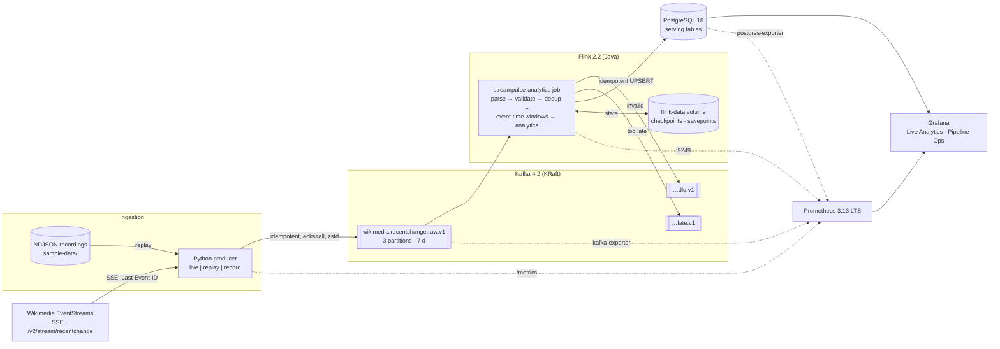
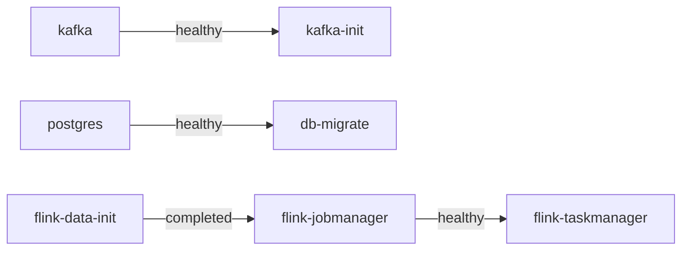
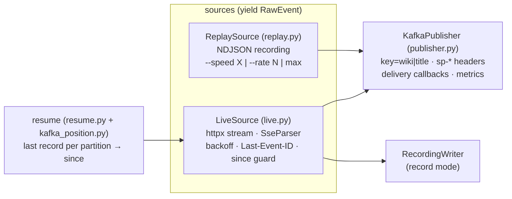
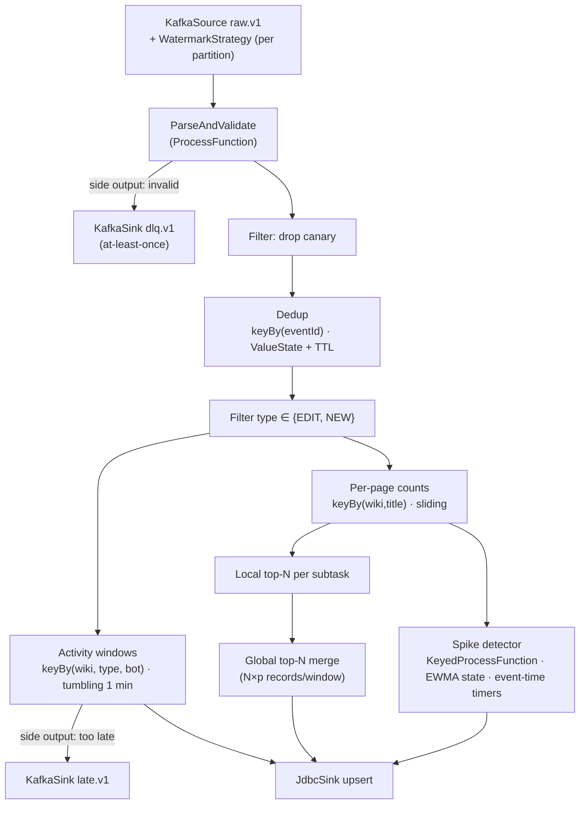
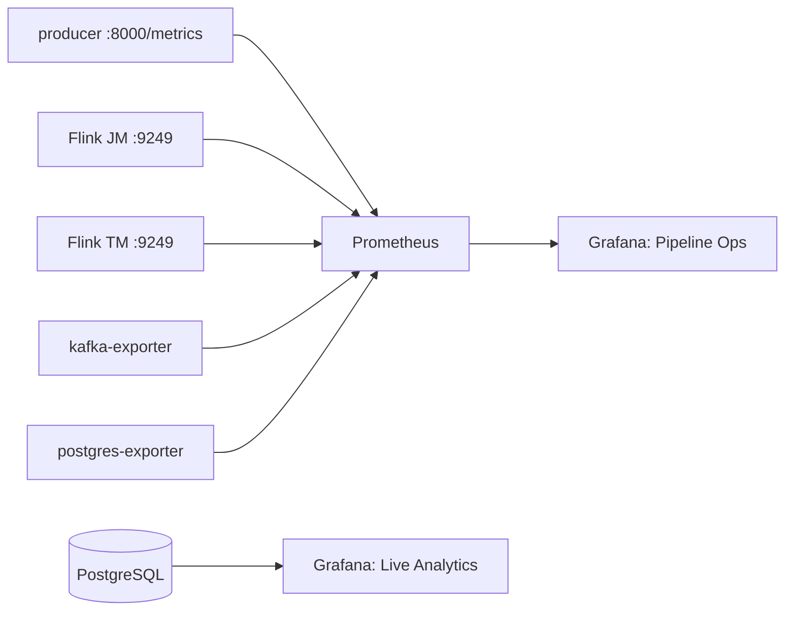

# StreamPulse — Architecture

> **Document status:** Phase 2 implemented (ingestion); 24-hour source measurement in progress. Sections are 📐 *designed* unless marked ✅ *Implemented*.
> Status markers: ✅ Implemented · 🧪 Implemented, pending measurement · 📐 Designed (planned) · ❓ Open question.
>
> Every claim is labelled where it matters: **FACT** (documentation or direct observation), **DECISION** (our choice), **ASSUMPTION** (needs measurement), **EXPERIMENT** (scheduled test).
>
> Last updated: 2026-10-28 (Phase 2).

## Contents
1. [Overview and engineering objectives](#1-overview-and-engineering-objectives)
2. [Implementation status](#2-implementation-status)
3. [High-level architecture](#3-high-level-architecture)
   - 3.1 [Local platform](#31-local-platform)
4. [The source: Wikimedia EventStreams](#4-the-source-wikimedia-eventstreams)
5. [Producer](#5-producer)
6. [Kafka topology](#6-kafka-topology)
7. [Data contracts and schema evolution](#7-data-contracts-and-schema-evolution)
8. [Flink job topology](#8-flink-job-topology)
9. [Event time, watermarks and late events](#9-event-time-watermarks-and-late-events)
10. [State, deduplication and TTL](#10-state-deduplication-and-ttl)
11. [Windowed analytics](#11-windowed-analytics)
12. [Trending and spike detection](#12-trending-and-spike-detection)
13. [Invalid events and the DLQ](#13-invalid-events-and-the-dlq)
14. [PostgreSQL serving model](#14-postgresql-serving-model)
15. [Delivery semantics, boundary by boundary](#15-delivery-semantics-boundary-by-boundary)
16. [Checkpointing and recovery](#16-checkpointing-and-recovery)
17. [Observability](#17-observability)
18. [Failure scenarios](#18-failure-scenarios)
19. [Security and configuration](#19-security-and-configuration)
20. [Performance and scalability](#20-performance-and-scalability)
21. [Cloud mapping](#21-cloud-mapping)
22. [Decisions index and limitations](#22-decisions-index-and-limitations)
23. [Repository structure](#23-repository-structure)

---

## 1. Overview and engineering objectives

StreamPulse ingests Wikimedia's worldwide live change stream (about 47 events/s, of which about 20/s are edits, measured 2026-10-26) and computes real-time analytics: activity, human vs bot, top and trending pages, and spikes. The results are served from PostgreSQL to Grafana.

**Headline question:** *can Wikipedia editing activity detect breaking news, and how quickly?* Spike detection is validated against an independent signal (Phase 4).

**Two deliverables** ([ADR-0013](adr/0013-public-showcase.md)):
1. **The engineering system:** this repository, runnable locally with `make up` / `make demo`.
2. **A public static showcase:** zero-install, on GitHub Pages. It shows a live in-browser view of the stream (connecting directly to Wikimedia; CORS verified), real results exported from recorded runs of this pipeline, and the engineering proof. The full stack is not hosted publicly.

The **engineering objective** matters as much as the product. The repository should show *how a production-minded data engineer reasons about streaming*:
- correctness is defined precisely, as event time with explicit lateness and deduplication;
- guarantees are stated per boundary and proven by an automated crash test;
- operational behaviour is observable;
- every number is measured.

Non-goals for V1: ML, multi-region deployment, Kubernetes, and serving raw event-level queries.

## 2. Implementation status

| Component | Status | Phase |
|---|---|---|
| Research, ADRs, roadmap | ✅ Implemented (documents) | 0 |
| Docker Compose: Kafka, Flink, PostgreSQL, init jobs, smoke test | ✅ Implemented | 1 |
| Python producer (live, replay, record), CI | ✅ Implemented (24-hour measurement running) | 2 |
| Flink parsing, validation, DLQ, watermarks, dedup, lateness | 📐 | 3 |
| PostgreSQL schema, upsert sink, core analytics, local Grafana | 📐 | 3 |
| Top-N, trending, spike detection and its validation | 📐 | 4 |
| Crash or recovery test, Prometheus, operations dashboard, throughput ceiling | 📐 | 5 |
| Public static showcase, `make demo`, release | 📐 | 6 |
| Full backpressure study, savepoint upgrade and rescaling demos | stretch | — |

## 3. High-level architecture



**Data path:** Wikimedia → producer → `raw` → Flink → PostgreSQL → Grafana.

**Control and telemetry path:** each component exposes metrics that Prometheus pulls. Grafana reads both Prometheus (operations) and PostgreSQL (analytics). Telemetry never travels on the data path, so a broken pipeline stays observable.

**Why this shape?** Kafka decouples a volatile external source from our processing. The producer's only job is to make the source durable, and everything downstream can be rebuilt from `raw`. This is the core idea: **an immutable, replayable log as the system of record**.

### 3.1 Local platform

✅ Implemented in Phase 1 ([`docker-compose.yml`](../docker-compose.yml)). Verified by `scripts/smoke_test.sh` (PASS) and by destroying and recreating all containers.

**Services:**

| Service | Image (pinned) | Kind | Role | Host port | Memory limit |
|---|---|---|---|---|---|
| `kafka` | `apache/kafka:4.2.2` | long-running | single-node KRaft broker and controller | `127.0.0.1:9094` | 1 GiB (heap 768 MB) |
| `kafka-init` | same | one-shot | creates the 3 topics and enforces their configs ([`create-topics.sh`](../infra/kafka/create-topics.sh)) | — | — |
| `postgres` | `postgres:18.6-bookworm` | long-running | serving database | `127.0.0.1:5432` | 512 MiB |
| `db-migrate` | `flyway/flyway:13.10.0-alpine` | one-shot | applies [`database/migrations`](../database/migrations/) | — | — |
| `flink-data-init` | `flink:2.2.1-scala_2.12-java17` | one-shot | creates checkpoint/savepoint dirs owned by uid 9999 | — | — |
| `flink-jobmanager` | same | long-running | cluster coordinator, REST API and UI, checkpoint coordinator | `127.0.0.1:8081` | 1.5 GiB (process 1200 MB) |
| `flink-taskmanager` | same | long-running | runs operators; 2 task slots; RocksDB state | — | 2.5 GiB (process 2048 MB) |
| `flink-jobs-build` | `maven:3.9.16-eclipse-temurin-17` | tool (profile `build`) | builds and tests the job jar; no host JDK needed | — | — |

**Startup order.** Dependencies are explicit health or completion conditions, never sleeps:

- Health checks: Kafka answers `kafka-broker-api-versions`; PostgreSQL answers `pg_isready`; the JobManager's REST `/overview` responds; the TaskManager counts as healthy once it appears in the JobManager's `/taskmanagers`.
- `scripts/wait_for_stack.sh` (called by `make up`) waits until long-running services are `healthy` and one-shot services have exited 0. `docker compose up --wait` is **not** used, because it reports a successfully exited init container as a failure, so its result depends on timing (observed, see the learning journal).
- A fresh start to fully ready takes about 32 s. A clean-room run (fresh volumes, build from source, smoke test) takes about 1 min 24 s with a warm Maven cache. Both were measured once on the dev machine.

**State that must survive container loss** lives in named volumes:

| Volume | Mounted at | Contents |
|---|---|---|
| `kafka-data` | `/var/lib/kafka/data` | topic logs and KRaft metadata |
| `postgres-data` | `/var/lib/postgresql` | database. PostgreSQL 18 images keep data in `/var/lib/postgresql/18/docker`; mounting the ≤17 path `/var/lib/postgresql/data` would leave the real data in an anonymous volume |
| `flink-data` | `/flink-data` (JobManager and TaskManager) | `checkpoints/<job-id>/chk-N/`, `shared/`, `taskowned/`; `savepoints/` |

**How Flink gets its configuration:**
- The repository holds [`infra/flink/flink-properties.yaml`](../infra/flink/flink-properties.yaml) (flat `key: value` lines).
- [`entrypoint.sh`](../infra/flink/entrypoint.sh) strips comments and exports it as `FLINK_PROPERTIES`, then runs the image's own entrypoint, which writes each key into `conf/config.yaml` (as `-D` overrides).
- Verified through the REST endpoint `/jobmanager/config`.
- Why not mount a `config.yaml`? The image's entrypoint *writes* to the config file at startup, so a mounted repository file would be modified or would fail as read-only.

**Ports are bound to `127.0.0.1` only**, so nothing is reachable from other machines on the network.

**Job deployment (Phase 1):** a session cluster. The jar is built into `flink-jobs/dist/` and mounted read-only into the JobManager, then submitted with `flink run -d`. The `dist/` directory is committed (`.gitkeep`). If a bind-mount source is missing, Docker creates it owned by root, which would block later non-root builds. The Phase 5 failure tests may move to application mode.

## 4. The source: Wikimedia EventStreams

📐 Full evidence: [Research 0001](research/0001-eventstreams-source-validation.md). Decision: [ADR-0001](adr/0001-source-stream-selection.md).

| Aspect | Value |
|---|---|
| Endpoint | `https://stream.wikimedia.org/v2/stream/recentchange` (FACT) |
| Protocol | SSE over chunked HTTP. The `id:` is a JSON array of `{topic, partition, timestamp}` per upstream DC topic (FACT) |
| Resume | `Last-Event-ID` header or `?since=`. 7–31 days of history (FACT) |
| Connection lifetime | Closed by WMF after at most **15 minutes** (FACT, docs). **Observed 2026-10-28:** streams dropped mid-body every 2–13 min and never closed cleanly; cause (upstream vs network path) still to be measured ([Research 0002 §1.8](research/0002-ingestion-behaviour.md)). Reconnecting is routine |
| Filtering | Client-side only (FACT) |
| Canary events | `meta.domain == "canary"`, several per hour. Discard them (FACT) |
| Contract | JSON Schema `mediawiki/recentchange` 1.0.1. Only `$schema`, `meta.dt` and `meta.stream` are required, and `additionalProperties: true` (FACT) |
| Observed drift | Events declare 1.0.0 and carry five undocumented fields (FACT) |
| Identity | `meta.id` (UUID). There is **no `page_id`**; page = `(wiki, title)` (FACT, DECISION) |
| Event time | `timestamp` (s); `meta.dt` (ms) is emission time, 30 ms–50 s later (FACT) |
| Mix | 52% categorize, 37% edit, 6% new, 5% log; 52% of edits are bot-flagged; 34% of edits are on Wikipedia (FACT, one 2-minute sample) |

**If the component fails:** Wikimedia outages or disconnects make the producer back off and resume. Data generated during an outage is recoverable from upstream history if the outage is shorter than retention.

**At production scale:** WMF's own docs say production services should consume their Kafka directly rather than the public SSE endpoint. An internal team would do that.

## 5. Producer

✅ Implemented in Phase 2 ([`producer/`](../producer/)). 74 tests: 65 unit, 9 against the real broker; all green in CI. Decisions: [ADR-0005](adr/0005-serialization-and-schema-contracts.md), [ADR-0012](adr/0012-producer-resume-from-kafka.md). Evidence: [Research 0002](research/0002-ingestion-behaviour.md).

**What and why:** a small Python service that turns the volatile SSE source into durable Kafka records, and replays recordings through the same publishing path.

**How it works:**


| Module | Responsibility |
|---|---|
| `sse.py` | WHATWG-conformant incremental SSE parser: multi-line data, comments, persistent `id`, `retry` |
| `envelope.py` | Peeks at the payload for the key, `meta.dt` and canary flag only; never modifies or drops it |
| `live.py` | Connect, stream and reconnect; backoff with full jitter; `since` sent as ISO-8601; checks that the first event matches the requested `since`; labels each reconnect by what happened (`classify_transport_error`) |
| `replay.py` | Pacing by recorded timing ×speed, fixed rate, or unpaced |
| `publisher.py` | Produce with key, headers and timestamp; blocks on a full local queue (backpressure); counts acks and failures; `flush()` raises on any failure |
| `resume.py`, `kafka_position.py` | Resume decision from the raw topic's last records (pure function plus Kafka reader). Transient Kafka errors are retried with backoff (`with_retries`), because CI exposed a startup race (`_DESTROY_BROKER`) |
| `clock.py` | SNTP clock-offset probe, exported as a metric |
| `app.py`, `cli.py` | Wiring, signals and settings; every option also comes from `STREAMPULSE_*` env vars |

**Key behaviour (each verified):**
- **One pipeline, interchangeable sources.** Both modes emit the same `RawEvent` into the same publisher, so replay tests the real publishing code. Verified by the integration test replaying the fixture into a real broker.
- **Bytes forwarded verbatim.** Malformed payloads are published with a null key, never dropped, so the Flink DLQ can see them. The integration test checks every record is byte-identical to the recording.
- **Kafka settings:** `enable.idempotence=true`, `acks=all`, zstd, `linger.ms=50`, `delivery.timeout.ms=120000`, `partitioner=murmur2_random`. **Verified:** every record landed on the partition Java's `murmur2` would choose. The test implements Kafka's hash and matches all six reference values from Kafka 4.2.2's `UtilsTest`.
- **Headers:** `sp-ingest-ts`, `sp-sse-id`, `sp-mode`, `sp-producer`, `sp-connection` (`live-<session>-<n>`), plus `sp-replayed-at` on replay. The Kafka record timestamp is the ingest time for live, and **the replay time for replay**, because retention deletes by record timestamp.
- **Reconnect:**
  - A connection that lived at least 60 s and delivered events reconnects immediately.
  - Otherwise, exponential backoff with full jitter (1 s base, 60 s cap), honouring `Retry-After`.
  - Before every reconnect the publisher is flushed, so `Last-Event-ID` refers to an acknowledged event. A delivery failure stops the producer instead of moving on.
- **Restart:**
  - Resume from the oldest last-record position across partitions, minus a 30 s margin ([ADR-0012](adr/0012-producer-resume-from-kafka.md)).
  - **Measured:** overlap exactly 30.0 s, no gap.
  - Guards: a `since` mismatch stops with exit 1; a resume point older than 24 h is refused with exit 2.
- **Shutdown:** SIGTERM → stop reading → flush (up to 30 s) → exit 0. **Measured:** `docker stop` → exit 0 in 0.5 s. Compose `stop_grace_period` is 45 s.
- **Replay preserves** the original `sp-ingest-ts`, so validation relative to ingest time is deterministic.

**Deployment:** Docker image `streampulse-producer:0.1.0` (python:3.14.8-slim, uv-locked dependencies, non-root uid 10001). Compose service `producer` is under the **opt-in profile `live`** (`make ingest`), so `make up` alone never contacts Wikimedia or grows the raw topic.

**Metrics (`:8000/metrics`):**
- `events_received` and `events_produced` by mode;
- `produce_errors` by reason;
- `local_queue_full`;
- `reconnects` by cause: `server_closed` (clean end), `stream_interrupted` (dropped mid-body), `connect_error` (DNS, refused, connect timeout), `timeout` (no data for 30 s), `network_error`, `http_<status>`;
- `connection_lifetime_seconds` (histogram; Wikimedia's documented maximum is 900 s);
- `produce_latency_seconds` (histogram, aggregatable);
- `source_delay_seconds` (receive − `meta.dt`; includes clock offset and, during a catch-up, the backlog's age);
- `unparseable_events`, `canary_events`;
- `last_event_emitted_timestamp_seconds`;
- `clock_offset_seconds`.

All names carry the `streampulse_producer_` prefix.

**Communicates with:** Wikimedia (HTTPS out), Kafka (binary protocol), Prometheus (it serves `/metrics`, scraped from Phase 5), and an NTP server (one UDP query at startup).

**Why Python:** an I/O-bound adapter with a mature client (librdkafka). This is the owner's strongest language, and the logic is simple.

**Alternatives:** Kafka Connect with an SSE source connector (heavier, with less control over resume semantics), or a Java producer (no benefit here). For the HTTP client, httpx (sync streaming) was chosen over `requests` for explicit per-phase timeouts and a mock transport that makes reconnect logic testable without the network. The SSE parser is our own, about 60 lines, because we need exact control of `id` semantics.

**If it fails:**
- **Kafka down:** the client retries until `delivery.timeout.ms` (2 min). A full local queue blocks reading upstream (backpressure). A failed delivery makes `flush()` raise and the producer exit 1; Compose restarts it, and it resumes from Kafka's last position.
- **Producer crash:** in-flight records are lost from Kafka but re-fetched on resume (overlap = margin).
- **Wikimedia ignores or misreads the resume request:** detected at the first event (guard), and the producer stops instead of ingesting the wrong period.
- **Internet outage (observed 2026-10-28, about 8 min):** DNS failures (`connect_error`), backoff with jittered waits capped at 60 s, then a `Last-Event-ID` resume caught up 20,423 events in 84 s with no gap.
- **Kafka not fully ready at startup:** transient errors are retried (5 attempts, exponential backoff); anything else stops the producer.

**At production scale:** run it as a single active instance with leader election, or partition by upstream stream. Its health is part of the SLO. An internal WMF team would consume Kafka directly instead of SSE.

## 6. Kafka topology

✅ Topics, partitions and configs implemented in Phase 1 ([`create-topics.sh`](../infra/kafka/create-topics.sh), idempotent). 📐 Producers and consumers arrive in Phases 2–3. Decision: [ADR-0004](adr/0004-kafka-topic-topology.md).

| Topic | Key | Partitions | Retention | Consumers |
|---|---|---|---|---|
| `wikimedia.recentchange.raw.v1` | `wiki\|title` | 3 | 7 d + byte cap | Flink job |
| `wikimedia.recentchange.dlq.v1` | null | 1 | 14 d | Humans, tools |
| `wikimedia.recentchange.late.v1` | `wiki\|title` | 1 | 14 d | Audit, metrics |

**Concepts as they apply here:**
- **Partition:** an ordered, append-only log. Ordering holds only *within* a partition. Keying by page keeps one page's events ordered, and spreads load (keying by wiki would put 36% on one partition).
- **Offset:** a record's position in a partition. Consumers own their position, and **replay = moving the position back**.
- **Consumer group:** consumers sharing a `group.id` split partitions between them.
  - **FACT:** Flink's `KafkaSource` **assigns partitions itself** and stores offsets in *Flink checkpoints*. The `group.id` is used only to commit offsets back to Kafka on checkpoint completion, for monitoring.
  - Recovery never uses committed offsets.
- **Local broker:** single-node KRaft (combined broker and controller), replication factor 1, `min.insync.replicas=1`. Production: three or more brokers, RF=3, `min.insync.replicas=2`, and a separate controller quorum.
- **Listeners (✅):** `INTERNAL://kafka:9092` for containers, `EXTERNAL://localhost:9094` for host tools, `CONTROLLER://kafka:9093` for KRaft. A client receives the *advertised* address in metadata and reconnects to it. That is why containers and the host need different listeners.
- **`auto.create.topics.enable=false` (✅):** a misspelled topic name fails loudly instead of silently creating a new topic with default settings.
- **Topic names use only dots (FACT):** Kafka warns that `.` and `_` collide in metric names, so a name should use one or the other, never both.
- **Observed (✅, smoke test):** with checkpointing on, the consumer group's committed offsets reached the topic's end offsets only after a checkpoint completed. That matches the FACT above.

**If Kafka fails:**
- The producer buffers, then applies backpressure to upstream reading, and resumes later from upstream history.
- Flink fails its source and restarts per the restart strategy, resuming from checkpointed offsets once Kafka returns.
- No data is lost, as long as Kafka's disk survives and the outage is shorter than upstream retention.

## 7. Data contracts and schema evolution

✅ Raw-topic contract implemented in Phase 2. ✅ `EditEvent`, parser and DLQ contract implemented in **Phase 3a** ([`contract/`](../flink-jobs/src/main/java/io/github/arttgrantollii/streampulse/contract/)), with 46 unit and contract tests. Decision: [ADR-0005](adr/0005-serialization-and-schema-contracts.md).

There are three contracts:

1. **Upstream contract:** Wikimedia's JSON Schema (vendored in `schemas/wikimedia/`). It is used for fixtures and tests, but is *not* trusted as a runtime guarantee, because it is already drifting.
2. **Raw topic contract:** value = the upstream bytes verbatim, plus `sp-*` headers. Versioned by the topic suffix `.v1`.
3. **Internal contract:** the Java record `EditEvent` v1, the only type analytics code sees.

```text
EditEvent v1
  eventId          String   meta.id                     (required)
  eventTimeMs      long     timestamp*1000 | meta.dt     (required; see §9)
  eventTimeSource  enum     TIMESTAMP | META_DT
  emittedAtMs      long     meta.dt                     (required by upstream schema)
  ingestTimeMs     long     header sp-ingest-ts         (required)
  type             enum     EDIT | NEW | LOG | CATEGORIZE | EXTERNAL | UNKNOWN
  wiki             String   wiki                        (required for EDIT/NEW)
  serverName       String   server_name
  namespace        Integer  namespace (nullable)
  title            String   title                       (required for EDIT/NEW)
  bot              Boolean  bot (nullable → counted as "unknown")
  user             String   user (nullable)
  revisionNew/Old  Long     revision.new / revision.old (nullable)
  lengthNew/Old    Integer  length.new / length.old     (nullable)
  rcId             Long     id (nullable; null for some log events)
  sourceSchema     String   $schema
  kafka            topic/partition/offset of the raw record (for DLQ/debug)
```

**Implemented as (3a):**
- `EditEvent`: a Java record with 22 fields.
  - **FACT:** Flink 2.2 serializes it with its POJO serializer, not Kryo (`EditEventTypeTest`). That matters for evolving state across upgrades.
  - The serializer round-trip is tested with nulls.
- `EditEventParser`:
  - Jackson 2.18.2 tree model with `FAIL_ON_TRAILING_TOKENS`.
  - Typed accessors: absent or JSON `null` becomes `null`, a wrong type is rejected, and nothing is coerced.
  - `meta.dt` is parsed as `OffsetDateTime`, so both `Z` and explicit offsets are accepted.
  - Ingest time comes from `sp-ingest-ts`, falling back to the Kafka record timestamp.
  - Returns `ParseResult.Valid` or `ParseResult.Invalid(DlqRecord)`. Rejection is an expected outcome, so no stack traces are created.
- **Event-time sanity bounds, refined from Phase 2 evidence:**
  - More than **5 min after ingest** → `impossible_time` for **every** type, because a future timestamp would push watermarks ahead.
  - More than **31 days before ingest** → `impossible_time` for **edits only**, because old timestamps are legitimate on log events (the 2005 Commons upload, Research 0002 §1.5).
- **Tested on real data:** all 120 fixture events parse; meta.dt ≥ timestamp holds for every one; `new` events have no previous revision.

**Evolution rules:**
- unknown upstream fields → ignored;
- optional fields missing → null, never a crash;
- a required field missing → DLQ with a reason;
- an upstream type change on a field we use → DLQ (`incompatible_type`), plus an alert on the DLQ rate;
- internal schema changes are additive within v1.

**State serialization caveat:** `EditEvent` objects stored in Flink state must stay serializer-compatible across job upgrades. That means POJO or Avro-style evolution, and explicit operator UIDs (Phase 5).

## 8. Flink job topology

📐 Phases 3–4. Decision: [ADR-0002](adr/0002-flink-java-over-pyflink.md).

There is a single job, `streampulse-analytics`, in a session cluster (1 JobManager, 1 TaskManager, initial parallelism 2, an ASSUMPTION).



**Operator responsibilities:**
- **Source:** reads splits (partitions) and emits watermarks per split.
- **ParseAndValidate:** the only place that touches JSON. It produces `EditEvent` or a DLQ record.
- **Dedup:** drops repeated `meta.id` values.
- **Windows:** event-time aggregation that emits absolute values.
- **Top-N:** two-phase, to avoid one operator receiving every page.
- **Sinks:** idempotent writes.

**Operator chaining:** source → parse → filter will be chained into one task (no serialization in between). `keyBy` boundaries are network shuffles. We will confirm this in the Flink UI job graph in Phase 3.

**Production scale:** separate jobs per concern (ingestion and quality vs analytics) connected by a `clean` topic, so each can be deployed and scaled independently. That is the trigger for Option C in [ADR-0008](adr/0008-postgres-sink-semantics.md).

## 9. Event time, watermarks and late events

📐 Phase 3. Decision: [ADR-0006](adr/0006-event-time-and-watermarks.md).

**Event time vs processing time.** *Event time* is when the edit happened (`timestamp`). *Processing time* is when our operator sees it. Counting by processing time would give a different answer every time we replay, and would smear a burst across however long ingestion took. We count by event time.

**Watermark.** A watermark W(t) is Flink's assertion that no more events with timestamp ≤ t are expected. A window [12:00, 12:01) fires when the watermark passes 12:01. We use bounded out-of-orderness: `W = max_timestamp_seen − B`.

```text
event-time →  12:00:00 ............ 12:01:00 ...... 12:01:10 ....... 12:03:00
              [ window 12:00–12:01 )
                                    watermark passes 12:01 when max_seen ≥ 12:01:10 (B = 10 s)
                                    → window fires (first result)
              events for this window arriving while W < 12:03:00 (L = 2 min)
                                    → window re-fires with the corrected full count (upsert)
              events arriving after W ≥ 12:03:00 → side output → late.v1
```

**Policy and parameters:**

| Parameter | Initial value | Basis | Status |
|---|---|---|---|
| Event-time field | `timestamp` (fallback `meta.dt`) | semantics (§4) | DECISION |
| Out-of-orderness B | 10 s | p99 of disorder in a 2-minute sample (8 s) | ASSUMPTION → R-2 |
| Allowed lateness L | 2 min | max observed was 50 s | ASSUMPTION → R-2 |
| Idleness I | 30 s | replay and fixture safety | ASSUMPTION |
| Sanity bounds | +5 min future, −31 days past (vs ingest time) | upstream retention maximum | DECISION |

**Idle partitions:** the watermark is the *minimum* across partitions. One silent partition would freeze all windows, so `withIdleness` excludes it until it produces again.

**Hazards (documented, to be tested):** timing-dependent lateness classification during replay, and watermark reset after restore (see [ADR-0006](adr/0006-event-time-and-watermarks.md) consequences).

## 10. State, deduplication and TTL

📐 Phases 3 and 4. Decision: [ADR-0007](adr/0007-deduplication.md), [ADR-0009](adr/0009-state-backend-and-checkpoint-storage.md).

| Operator | State type | Key | Size estimate | Bounded by |
|---|---|---|---|---|
| Kafka source | operator (split offsets) | — | bytes | — |
| Dedup | keyed `ValueState<Boolean>` | `meta.id` | ~170 k keys ≈ 17 MB (H = 1 h) | processing-time TTL |
| Activity windows | window state | `(wiki, type, bot)` | ~600 keys × open windows | window end + L |
| Per-page sliding counts | window state | `(wiki, title)` | ~65 k pages per 5 minutes (ASSUMPTION) | window end + L |
| Spike baseline | keyed `ValueState<Baseline>` | `(wiki, title)` | **potentially millions per day** | event-time timer: clear after 6 h idle |
| Top-N | small keyed/window state | window | N × parallelism | window |

**Keyed state** is partitioned by key across subtasks, and moves with key groups on rescale. The maximum parallelism (`maxParallelism`) fixes the number of key groups forever, so it is set explicitly (e.g. 128) in Phase 3. **State TTL** in Flink is processing-time based (FACT), which is suitable for dedup ([ADR-0007](adr/0007-deduplication.md)) but not for event-time baselines. Those use event-time timers.

## 11. Windowed analytics

📐 Phase 3.

| Metric | Window | Key | Definition |
|---|---|---|---|
| Edits per minute | tumbling 1 min | `(wiki, type, bot)` | count of EDIT+NEW, absolute per window |
| Edits/s (dashboard) | derived | — | per-minute count / 60. Sub-minute rates come from Prometheus producer metrics, which are operational rather than event-time |
| By wiki / language / project family | join to `dim_wiki` at query time | — | language from the Wikimedia **sitematrix**, *not* parsed from subdomains (`simple`, `be-tarask` and `als` are not ISO codes) |
| Human vs bot | in the activity key | — | `bot` flag; the share is computed in SQL |
| Bytes changed | tumbling 1 min | same | sum of `length.new − length.old` (nullable) |

## 12. Trending and spike detection

📐 Phase 4. Decision: [ADR-0010](adr/0010-spike-detection.md).

- **Top edited:** raw counts per page over the last 10 minutes (sliding, 1-minute slide), with human-only, content-namespace and family filters.
- **Trending** (proposed): `trend_score = (k − μ) / sqrt(μ + 1)` over a 10-minute window, where `μ` is the page's EWMA-expected count. This is a variance-stabilised excess, so it rewards *unusual* activity rather than steady activity. Ranking requires `k ≥ 3` and `distinct_editors ≥ 2`.
- **Spike:** a Poisson upper-tail test, k = 5-minute count vs EWMA baseline μ, with minimum volume, distinct editors, a strict significance level and a cooldown. Full rationale is in ADR-0010.

Both formulas are fixed only after replaying a 24 h recording (EXPERIMENT).

## 13. Invalid events and the DLQ

✅ DLQ record contract and rejection rules implemented in Phase 3a ([`schemas/streampulse/dlq-record.v1.json`](../schemas/streampulse/dlq-record.v1.json); `DlqRecordTest` validates real output against the schema). 📐 The Kafka DLQ sink comes in 3b.

| Category | Example | Route | Metric |
|---|---|---|---|
| `invalid_json` | truncated payload | DLQ | `dlq_records_total{reason}` |
| `missing_identity` | no `meta.id`; EDIT without `wiki`/`title` | DLQ | same |
| `missing_time` | neither `timestamp` nor `meta.dt` | DLQ | same |
| `impossible_time` | more than 5 min after ingest (any type), or an **edit** more than 31 d before ingest | DLQ | same |
| `incompatible_type` | `timestamp` as a string | DLQ | same |
| canary | `meta.domain=canary` | dropped | `canary_events_total` |
| duplicate | repeated `meta.id` | dropped | `duplicates_dropped_total` |
| **late (valid!)** | beyond allowed lateness | `late.v1` | `late_events_total` |

DLQ record (`schemas/streampulse/dlq-record.v1.json`, Phase 3):
`schema_version`, `reason`, `detail`, `raw_value` (string, possibly truncated with an original-length field), the raw record's topic/partition/offset/timestamp, the headers, `job_version` and `detected_at`.

## 14. PostgreSQL serving model

📐 Phase 3. Decisions: [ADR-0008](adr/0008-postgres-sink-semantics.md), [ADR-0011](adr/0011-postgresql-over-clickhouse.md).

Draft (finalised in Phase 3):
```sql
dim_wiki(wiki_id PK, server_name, project_family, language_code, language_name, is_closed, loaded_at)
fact_activity_1m(window_start, wiki_id, change_type, is_bot, edit_count, bytes_delta, updated_at,
                 PRIMARY KEY (window_start, wiki_id, change_type, is_bot))
top_pages(window_size, window_end, wiki_id, title, rank, edit_count, distinct_editors, updated_at,
          PRIMARY KEY (window_size, window_end, wiki_id, title))
spike_events(spike_id PK /* hash(wiki,title,window_end) */, wiki_id, title, window_end,
             current_count, expected_count, spike_score, threshold, page_url, detected_at)
```
- Natural primary keys enable idempotent upserts.
- Indexes lead with time, because Grafana always filters by a time range.
- Retention (e.g. 30 days) by scheduled delete or daily partitions, chosen from measured growth.
- Migrations are versioned SQL run by Flyway in a one-shot container.

## 15. Delivery semantics, boundary by boundary

📐 This is the central correctness claim. It is proven in Phase 5.

**Vocabulary:**
- **At-most-once:** never duplicated, possibly lost.
- **At-least-once:** never lost, possibly duplicated.
- **Exactly-once state consistency:** after recovery, Flink *state* reflects each input exactly once.
- **End-to-end exactly-once:** every *external effect* happens exactly once.
- **Idempotent write:** applying it twice equals applying it once, which turns at-least-once delivery into an exactly-once *effect*.

| Boundary | Mechanism | Guarantee we claim | Caveats |
|---|---|---|---|
| Wikimedia → producer | SSE + resume from Kafka-acked position, minus a margin | **At-least-once** (overlap duplicates) | Gaps if downtime exceeds upstream retention (7–31 d). Upstream may itself contain duplicates (R-3) |
| Producer → Kafka | `acks=all` + idempotent producer | **At-least-once** across restarts. No duplicates from retries *within* one producer session | Idempotence is per producer session (PID). RF=1 locally means the disk is a single point of failure |
| Kafka → Flink | KafkaSource offsets in checkpoints; replay from checkpoint offsets on failure | Source is replayable: **exactly-once state consistency** combined with checkpoints | Committed group offsets are for monitoring only |
| Flink state | Checkpoint barriers (aligned, EXACTLY_ONCE mode) | **Exactly-once state consistency** | Dedup removes *upstream* duplicates. Checkpoints prevent *recovery* duplicates in state |
| Flink → PostgreSQL | At-least-once JDBC sink + deterministic-key UPSERT of absolute values | **Effectively-once results** (convergent, idempotent) | Requires determinism. Watermark-after-restore hazard (ADR-0006). Restoring an *old* savepoint re-writes the same values |
| Flink → Kafka (DLQ, late) | KafkaSink `AT_LEAST_ONCE` | **At-least-once** | Duplicates possible. Records carry `meta.id` |

**What we will (and will not) say publicly:** "StreamPulse's result tables converge to the same values after a TaskManager crash, verified by an automated test", with measured numbers. We will **not** say "end-to-end exactly-once" or "zero data loss".

## 16. Checkpointing and recovery

✅ Backend, storage and configuration implemented and verified in Phase 1. 📐 Interval tuning and crash tests come in Phase 5. Decision: [ADR-0009](adr/0009-state-backend-and-checkpoint-storage.md).

**Verified in Phase 1 (smoke test):**
- RocksDB keyed state works on the TaskManager.
- Checkpoints complete and land in `/flink-data/checkpoints/<job-id>/chk-N/_metadata`. `shared/` holds incremental SST files referenced by several checkpoints, and `taskowned/` holds state owned by tasks.
- Checkpoints are **retained after cancellation**.
- All of it survives `docker compose down` and `up`.
- A job-level override (`flink run -Dexecution.checkpointing.interval=5s`) takes precedence over the cluster default. The smoke test uses this to get checkpoints quickly.
- Unit level: [`CountRecordsTest`](../flink-jobs/src/test/java/io/github/arttgrantollii/streampulse/smoke/CountRecordsTest.java) snapshots keyed state, restores it into a fresh operator, and checks that counting continues (2 → 3), which is recovery in miniature.

**Checkpoint barriers:**
- The JobManager's checkpoint coordinator injects barrier *n* into every source.
- Each operator snapshots its state when barrier *n* has arrived on all inputs (alignment), then forwards it.
- When every sink has acknowledged, checkpoint *n* is complete.
- On failure, *all* operators restore checkpoint *n*, and sources rewind to the offsets recorded in it. That is why state is consistent: every operator's state corresponds to the same cut through the stream.

**Checkpoint vs savepoint:**

| | Checkpoint | Savepoint |
|---|---|---|
| Created by | Flink, periodically | The operator, on demand |
| Purpose | Automatic failure recovery | Upgrades, rescaling, migration, A/B |
| Format | May be incremental and backend-native | Canonical or native, portable, owned by the user |
| Lifecycle | Managed and retained per config | Never deleted automatically |

**Initial configuration** (Flink 2.2 keys, values are ASSUMPTIONS until Phase 5):

| Key | Value |
|---|---|
| `state.backend.type` | `rocksdb` |
| `execution.checkpointing.incremental` | `true` |
| `execution.checkpointing.dir` | `file:///flink-data/checkpoints` |
| `execution.checkpointing.savepoint-dir` | `file:///flink-data/savepoints` |
| `execution.checkpointing.interval` | `30 s` |
| `execution.checkpointing.mode` | `EXACTLY_ONCE` |
| `execution.checkpointing.timeout` | `2 min` |
| `execution.checkpointing.min-pause` | `10 s` |
| `execution.checkpointing.max-concurrent-checkpoints` | `1` |
| `execution.checkpointing.externalized-checkpoint-retention` | `RETAIN_ON_CANCELLATION` |
| `execution.checkpointing.num-retained` | `3` |
| `execution.checkpointing.tolerable-failed-checkpoints` | `3` |
| `restart-strategy.type` | `exponential-delay` |

**Trade-off of the interval:** shorter intervals mean less replay after failure and faster offset commits (so monitored lag looks smoother), at the cost of more checkpoint I/O.

## 17. Observability

📐 Phase 5.



**Signals and the question each one answers:**

| Area | Signal | Question |
|---|---|---|
| Producer | events received/produced/failed, reconnects by cause, produce-ack latency histogram, source delay (`recv − meta.dt`) | Is ingestion keeping up, and is upstream healthy? |
| Kafka | topic offset rate (`rate(kafka_topic_partition_current_offset)`), consumer-group lag | Throughput in, and is anything falling behind? |
| Flink | `numRecordsInPerSecond`, `busyTimeMsPerSecond`, `backPressuredTimeMsPerSecond`, `lastCheckpointDuration`, `numberOfFailedCheckpoints`, `numRestarts`, `currentOutputWatermark` (→ watermark delay = now − watermark), `pendingRecords` | Where is the bottleneck, and is the job healthy and progressing? |
| Application | DLQ by reason, late events, duplicates dropped, canary, spikes emitted | Data quality |
| PostgreSQL | connections, transaction rate, errors, sink batch latency | Is the sink the bottleneck? |

**Important FACTS that shape the design:**
- **Flink histograms → Prometheus *summaries*.** Quantiles are computed per subtask and **cannot be aggregated** across subtasks. For a fleet-wide p95/p99 we will expose **bucketed counters** (cumulative `le` buckets, like a Prometheus histogram) from a custom Flink metric. Alternatively, latency can be computed in SQL from per-window timestamps.
- **Consumer lag from kafka-exporter is a sawtooth.** Flink commits offsets only on checkpoint completion, so lag in Kafka terms can be up to one checkpoint interval stale. Flink's own `pendingRecords` is the accurate signal, and we show both and explain the difference.

**Latency definitions:**

| Name | Formula | Clock domain | Meaning |
|---|---|---|---|
| Source delay | producer receive − `meta.dt` | **ours vs Wikimedia's**, so skew-contaminated | Upstream pipeline plus network. Reported with a clock-offset caveat (we observed ~3–4 s of WSL clock drift) |
| Pipeline latency | sink write time − `sp-ingest-ts` | single host (Docker VM) | Our processing time, excluding upstream |
| Result freshness | row write time − window end | single host vs event time | How stale a dashboard number is. Includes the intentional watermark wait B |
| Event-to-result | row write time − last event time in window | mixed | The headline end-to-end figure, with caveats |

p50/p95/p99 are reported for each.

## 18. Failure scenarios

📐 Expected behaviour (validated in Phases 2 and 5).

| Scenario | Expected behaviour | Data impact | Verified by |
|---|---|---|---|
| Wikimedia closes the connection (15 min) | immediate reconnect with Last-Event-ID | small overlap → dedup | Phase 2 test and metric |
| Wikimedia outage | backoff; resume when it returns | none if shorter than retention | Phase 2 fault injection |
| Producer crash | restart (Compose `restart: unless-stopped`); resume from Kafka minus margin | overlap duplicates → dedup | Phase 2 |
| Kafka unavailable | producer buffers → errors → stops reading; Flink restarts and retries | none, upstream history covers the gap | Phase 5 |
| Partition idle | idleness excludes it from the watermark | none | Phase 3 test |
| Event 5 min late | beyond L = 2 min → `late.v1` + metric (not in aggregates) | counted separately | Phase 3 test |
| Same event twice | dedup within H = 1 h | none | Phase 3 test |
| Wikimedia adds a field | ignored | none | Phase 3 test |
| Wikimedia removes or retypes a field we use | DLQ with reason; DLQ-rate alert | records in DLQ, replayable after a fix | Phase 3 test |
| PostgreSQL slow | sink batches back up → backpressure → Kafka lag grows; nothing is lost | latency ↑ | Phase 5 experiment |
| PostgreSQL down | sink fails → job restarts and retries per strategy | none; upserts re-apply | Phase 5 |
| TaskManager dies | restart from the last checkpoint; replay since then | none in results (idempotent) | **Phase 5 crash test** |
| JobManager dies | no HA locally → resubmit from the retained checkpoint (runbook) | none if resubmitted within Kafka retention | Phase 5 runbook |
| Checkpoint fails | tolerated ×3, then the job fails over | none | Phase 5 |
| State grows for weeks | TTL and timers bound it; state-size metrics watched | none | Phase 5 measurement |
| Deploy a new job version | stop-with-savepoint → deploy → restore. Operator UIDs make state mapping stable | none | Phase 5 demo |
| Rescale | restore a savepoint at new parallelism (≤ maxParallelism) | none | Phase 5 |
| 100× traffic | see §20 | — | reasoning only |

## 19. Security and configuration

✅ Configuration hygiene implemented in Phase 1. 📐 PostgreSQL roles come in Phase 3.
- Configuration through environment variables. `.env.example` is committed and `.env` is gitignored. There are no credentials in code, Compose files or images. Compose fails fast (`${VAR:?}`) if a required variable is missing.
- Flyway's `clean` command (drop every object in the schema) is disabled with `FLYWAY_CLEAN_DISABLED=true`, so it can't be run against this database by accident. Telemetry is disabled (`REDGATE_DISABLE_TELEMETRY`).
- Separate PostgreSQL roles (Phase 3): a migration owner, a sink writer (DML on result tables only) and a Grafana reader (read-only). Least privilege, even locally.
- Kafka uses PLAINTEXT locally, which is documented as a local-only shortcut. Production would use TLS plus SASL (SCRAM or OAuth) with ACLs per principal.
- Services are exposed only on localhost ports.
- Wikimedia etiquette: a descriptive User-Agent with contact information, one connection, and no history requests beyond need.

## 20. Performance and scalability

📐 Phase 5 measures. The figures here are reasoning, not results.
- **Today:** about 47 events/s and 64 KB/s raw, which is tiny for Kafka and Flink. The likely first bottlenecks are the per-event JSON parse, RocksDB access on high-cardinality per-page state, and PostgreSQL upsert throughput.
- **At 100×** (about 5 k events/s, the scale of an internal WMF consumer):
  - more partitions (e.g. 24) and higher parallelism;
  - many TaskManagers;
  - RocksDB tuning or ForSt disaggregated state;
  - unaligned checkpoints if backpressure is persistent;
  - the sink writes only aggregates, so PostgreSQL load scales with *keys per window*, not events;
  - top-N must be two-phase (already the design);
  - and splitting ingestion and analytics into separate jobs with a `clean` topic.

## 21. Cloud mapping

📐 Documentation only (stretch goal).

| Local | AWS | Azure | GCP |
|---|---|---|---|
| Kafka (KRaft) | MSK / Confluent Cloud | Event Hubs (Kafka API) / Confluent | Managed Service for Apache Kafka / Confluent |
| Flink session cluster | Managed Service for Apache Flink, or EKS + Flink Operator | AKS + Flink Operator, or HDInsight on AKS | GKE + Flink Operator |
| Checkpoint volume | S3 | ADLS Gen2 | GCS |
| PostgreSQL | RDS / Aurora | Azure Database for PostgreSQL | Cloud SQL / AlloyDB |
| Prometheus / Grafana | Amazon Managed Prometheus / Managed Grafana | Azure Monitor managed Prometheus / Managed Grafana | Managed Service for Prometheus / Grafana Cloud |

Things to verify then: Event Hubs' Kafka compatibility for *transactions* (a constraint on Option C), and managed-Flink connector versions.

## 22. Decisions index and limitations

ADRs: [index](adr/README.md). Versions: [COMPATIBILITY.md](COMPATIBILITY.md). Roadmap: [ROADMAP.md](ROADMAP.md).

**Known limitations (by design):**
- page identity is `(wiki, title)`, so it splits on page moves;
- single broker with RF=1;
- no JobManager HA locally;
- `timestamp` has 1-second resolution;
- source-delay latency is affected by clock skew;
- dedup horizon is 1 h;
- results are only as deterministic as the watermark behaviour (see the ADR-0006 hazards).

## 23. Repository structure

Items marked ✅ exist. The rest is the target; directories are created in the phase that first needs them.
```text
streampulse/
├── producer/                 # ✅ Python 3.14: live | replay | record
│   ├── src/streampulse_producer/   # ✅ sse, live, replay, publisher, resume, clock, …
│   ├── tests/                      # ✅ unit + integration (real Kafka)
│   ├── pyproject.toml, uv.lock     # ✅ exclude-newer enforces the two-week rule
│   └── Dockerfile                  # ✅
├── flink-jobs/               # ✅ Java 17, Maven. Phase 1 smoke job; Phase 3+ analytics
│   ├── src/main/java/io/github/arttgrantollii/streampulse/smoke/   # ✅ SmokeJob, CountRecords
│   ├── src/test/java/...                                           # ✅ operator-harness tests
│   ├── dist/                                                       # ✅ built job jar (mounted into the JobManager)
│   └── pom.xml                                                     # ✅
├── infra/
│   ├── kafka/create-topics.sh       # ✅ idempotent topic init
│   └── flink/                       # ✅ flink-properties.yaml + entrypoint.sh
├── database/migrations/      # ✅ Flyway V001__baseline.sql …
├── monitoring/
│   ├── prometheus/prometheus.yml
│   └── grafana/{provisioning,dashboards}/
├── schemas/
│   ├── wikimedia/recentchange-1.0.1.yaml   # vendored upstream contract
│   └── streampulse/{dlq-record,late-record}.v1.json
├── sample-data/fixtures/     # ✅ recentchange-120.ndjson (+ attribution); large recordings gitignored
├── scripts/                  # ✅ smoke_test.sh, wait_for_stack.sh, research/ (incl. analyze_raw_topic.py); failure_test (Phase 5)
├── .github/workflows/ci.yml  # ✅ producer lint+unit, integration (real Kafka), Flink build, compose+shellcheck
├── tests/e2e/                # cross-component tests (replay → Kafka → Flink → PostgreSQL)
├── docs/
│   ├── ARCHITECTURE.md  INTERVIEW_QUESTIONS.md  LEARNING_JOURNAL.md
│   ├── ROADMAP.md  COMPATIBILITY.md
│   ├── adr/  research/  runbooks/  images/
├── docker-compose.yml        # ✅
├── .env.example              # ✅
├── Makefile                  # ✅
├── README.md
└── LICENSE
```
